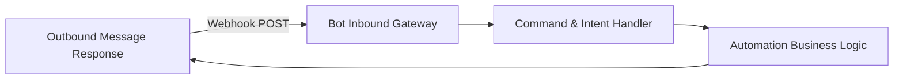
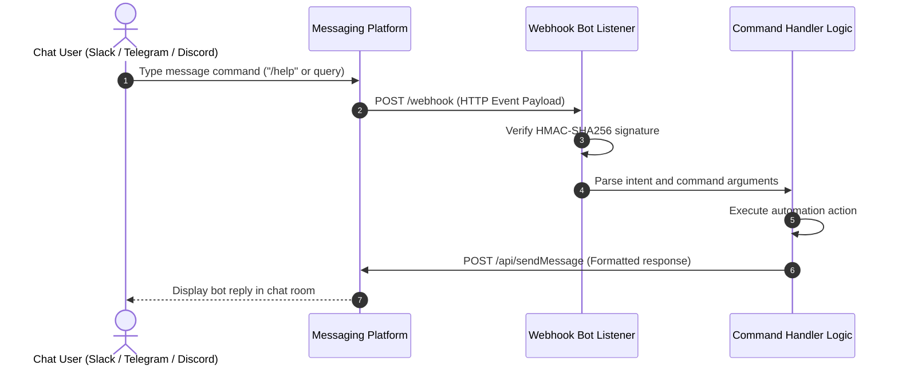

# Cloud Bot Starter — Conversational Automation Framework
[]()
[]()
[]()
[]()

## Overview
A lightweight starter template and scaffold designed for building conversational chat bots, automation webhooks, and messaging event handlers (Slack, Discord, Telegram, or WhatsApp).

- **Problem Solved:** Fast scaffolding for messaging automation workflows.
- **Target Users:** Developers building automated notifications and conversational agents.
- **Current Status:** Foundation Template / Scaffold.

## Features
- **Modular Event Dispatcher:** Structured design for handling inbound chat events.
- **Command Routing:** Easily extensible command and intent matching.
- **Webhook Gateway:** Clean HTTP listener interface for inbound platform webhooks.

## Architecture


## User Flow


## Technology Stack
| Layer | Technology | Purpose |
|---|---|---|
| Runtime | Node.js or Python | Automation script execution |
| Protocol | HTTP REST / WebSockets | Chat platform webhook reception |
| Tooling | Git | Version control |

## Infrastructure
- **Webhook Port:** 3000 / 8000
- **Deployment Platform:** Serverless Functions (AWS Lambda / Vercel) or containerized daemon.

## Project Structure
```text
Bot/
├── .gitignore           # Git ignore definitions
└── README.md            # Technical documentation & project specification
```

## Prerequisites
- Node.js >= 18.x or Python >= 3.10
- Active bot token from target chat provider (e.g., Discord Developer Portal or Telegram BotFather).

## Environment Variables
Copy `.env.example` to `.env` and configure placeholders:
```env
BOT_TOKEN=your_platform_bot_token_here
WEBHOOK_SECRET=your_webhook_secret_here
PORT=3000
```

## Local Development Setup
1. Clone the repository:
   ```bash
   git clone https://github.com/Bhanutejanallamothu/Bot.git
   cd Bot
   ```
2. Implement your chosen language driver (Node.js `discord.js` / Python `python-telegram-bot`).
3. Launch bot service.

## Docker Setup
Standard lightweight Alpine container recommended upon implementation.

## Database Setup
*Optional: Redis for conversation state memory.*

## API Documentation
- `POST /webhook` - Receives event payloads from chat provider.

## Deployment
Deploy to Railway, Render, or AWS Lambda.

## Security
- Always verify incoming webhook signatures (e.g., HMAC-SHA256).
- Never commit bot tokens into source control.

## Testing
Simulate webhook events using `curl` or Postman.

## Troubleshooting
- **Webhook Times Out:** Ensure your bot handler returns HTTP 200 immediately and processes heavier tasks asynchronously.

## Future Improvements
- LLM natural language intent classification.

## License
MIT License or Owner All Rights Reserved.
